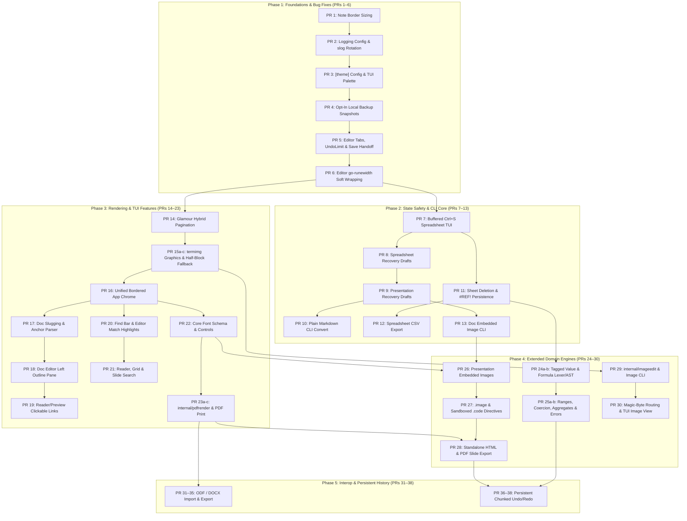

# Future Work

This document turns the items in the README's **Future work** section into
step-by-step, PR-sized implementation plans across five sequential phases (**38
focused Pull Requests** total, with Phase 5's external interop and persistent
history specifications detailed in
[`docs/ODF_DOCX_Interop_Plan.md`](docs/ODF_DOCX_Interop_Plan.md) and
[`docs/Persistent_Undo_Redo_Plan.md`](docs/Persistent_Undo_Redo_Plan.md)).
Every PR is scoped (`~200–600` LOC) so `main` stays buildable and passes
`go test -race ./...` after each merge.

The plans follow Parchment's boundaries: services own artifact rules,
repositories own file I/O, and the TUI presents those operations. Artifacts
remain ordinary user-named files; application state, logs, recovery drafts, and
persistent history belong under `~/.parchment/` (local backup snapshots live
outside `~/.parchment/` at a user-chosen destination).

## 1. Document navigation pane and in-document link navigation

Add structural navigation to documents. In-document link navigation, heading
slugs, anchors, and outline panes apply **strictly and exclusively to
Documents**; they do not apply to Notes (flat, unstructured notes) or
Presentations (slide-based sequencing).

### Document Editor & Reader Navigation Pane
- Add a dedicated navigation pane to the left side of the Document editor
  (visible by default on wide terminals `>= 80` columns, matching the Document
  reader).
- **Shortcuts & Focus Handling:**
  - `Ctrl+O` toggles outline pane visibility in both the Document editor and
    Document reader.
  - `F6` switches keyboard focus to the outline pane in the Document editor
    (`Up`/`Down` or `j`/`k` selects an entry, `Enter` jumps the editor cursor to
    that target and returns focus to the body, `Esc` returns focus to the body).
  - Free `Tab` inside the Document editor body (`focusBody`) so `Tab` inserts
    two spaces (matching Note and Presentation editors), while `F2` focuses the
    toolbar.
- **Outline Entries:** Dynamically parse and display headings (`H1`–`H6`,
  ignoring headings inside fenced code blocks), section breaks (labeled
  `"── Section (N cols)"`), and explicit HTML anchors (labeled `"#id"`).
- Clicking an entry with the mouse or pressing `Enter` on a focused outline
  entry moves `editor.Model`'s `Cursor` (`Point{Line, Col: 0}`) and scrolls the
  soft-wrapped editor viewport directly to that source line.

### In-Document Links in Preview and Reader Views Only
- In the text editor, Markdown links (`[text](#anchor)`) remain plain editable
  text. Links are **only clickable within the rendered document preview and
  reader views**.
- **Pre-Render Link Rewrite & Ordered Post-Render Search:**
  - Before invoking Glamour per-column rendering, rewrite internal links
    `[text](#target)` to their bare `text` label (so Glamour never prints raw
    destination `(#slug)` URLs in the output) while recording an ordered list
    of `(text, target)` pairs.
  - After rendering, strip ANSI styling per row, locate each link label in
    document order across rendered rows (accounting for line wrapping across
    consecutive rows), re-apply the active theme `link` style to those column
    spans, and register `(page, row, startCol, endCol, target)` hit-test boxes.
  - Mouse clicks on rendered internal links jump the reader/preview directly to
    the target page and heading/anchor line. Unresolved internal links and
    external URLs remain styled as links without navigating.

### Slugging & Explicit Anchors
- Parse heading targets using deterministic GitHub-compatible slugging
  (lowercase, spaces replaced by `-`, punctuation stripped, duplicate headings
  disambiguated with `-1`, `-2` suffixes).
- Support explicit HTML anchor targets (`<a name="..."></a>` and
  `<a id="..."></a>`) in the document body, resolving them to their source
  lines and paginated pages.
- Keep outline and slug extraction purely read-only in `internal/document`,
  never mutating canonical Markdown.

### PR Breakdown
- **PR 17:** Heading slugging (`-1`/`-2` duplicate disambiguation), `<a id|name>`
  explicit anchor parsing, fenced-code exclusion, and section-break/anchor
  outline extraction in `internal/document`.
- **PR 18:** Document editor left navigation pane, `Ctrl+O` visibility toggle
  (editor & reader), `F6` outline focus, freeing `Tab` in body to insert 2
  spaces, and mouse/keyboard cursor jumping in `internal/tui`.
- **PR 19:** Pre-render link rewrite (suppressing raw `(#slug)` URLs in
  Glamour) and ordered post-render ANSI line coordinate tracking across
  paginated columns with mouse click navigation in Document reader & `F5` preview.

**Acceptance:** The Document editor displays a toggleable (`Ctrl+O`) and
focusable (`F6`) left navigation pane (with `Tab` inserting two spaces in the
body), and Document preview/reader views jump to target pages/headings when
rendered internal links are clicked.

## 2. Explicitly convert plain Markdown files

Add an explicit CLI-only conversion operation turning a plain Markdown file
into a typed Parchment artifact (`document`, `note`, or `presentation`) in
place after confirmation.

- **CLI Contract:**
  - `parchment convert <file> [--kind document|note|presentation] [--yes]`
  - Default `--kind` to `document` when omitted; reject unsupported kinds (such
    as `spreadsheet`). Never infer kind from filenames, never auto-convert when
    opening a plain Markdown file, and do not add an in-TUI conversion mode.
  - When stdin/stdout is an interactive TTY and `--yes` is not set, prompt
    `Convert <file> to a Parchment <kind> in place? [y/N]` and leave the file
    untouched unless confirmed. When non-interactive (piped/scripted), fail
    cleanly unless `--yes` is passed.
- **Metadata, Body Preservation & Safeguards:**
  - Refuse to convert any file that already has a `parchment-meta` block.
  - Set `created_at` to the source file's existing `ModTime().UTC()` and
    `modified_at` to `time.Now().UTC()`, with no stored ID, title, or path.
  - Preserve the plain Markdown body verbatim after `<!-- parchment-body -->`,
    constructing default kind data (`document.DefaultLayout()` in
    `parchment-document` for documents) and verifying lossless round-trip
    decoding before writing.
  - Detect external changes since reading, write atomically in the source
    directory, and preserve existing file permissions and symlink targets.

### PR Breakdown
- **PR 10:** Single self-contained PR adding repository/service conversion
  support, `parchment convert` CLI flags and TTY/`--yes` confirmation, and full
  unit/CLI tests.

**Acceptance:** Opening and saving plain Markdown retains plain-note behavior;
only confirmed `parchment convert` turns a plain file into a typed artifact.

## 3. Autosave spreadsheet and presentation recovery drafts

Unify the TUI save lifecycle across all four editors and extend
`~/.parchment/recovery/` draft protection to spreadsheets and presentations.

- **Buffered Spreadsheet Editing (`Ctrl+S`) & Undo Semantics:**
  - Update `spreadsheetModel` (`internal/tui/spreadsheet.go`) from immediate
    per-cell disk writes on `Enter` to buffered workbook editing matching
    notes, documents, and presentations: cell edits, row/column insertions and
    deletions, and sheet changes update the in-memory workbook (with local
    in-session undo/redo).
  - In-session `u`/`Ctrl+Z` and `Ctrl+R` undo and redo uncommitted buffer
    edits while dirty.
  - Pressing `Ctrl+S` writes atomically to disk via `TransitionSpreadsheet`,
    records **exactly one** service history entry (`"Update spreadsheet"`),
    triggers at most one local backup snapshot per save, and clears the in-session
    buffer undo/redo stacks.
  - When the in-session buffer stack is empty and the workbook is not dirty,
    `u`/`Ctrl+R` delegate cleanly to service-level persistent undo/redo.
  - `Esc`/`q` asks for confirmation when dirty.
- **Versioned Recovery Snapshots Schema:**
  - Wire `recovery.Store` into `openFile`, `spreadsheetModel`, and
    `presentationModel` (removing the early returns in `internal/tui/model.go`
    before `LoadRecovery`).
  - Spreadsheet draft snapshot (`Kind: "spreadsheet"`):
    ```go
    type spreadsheetRecoveryData struct {
        Baseline         spreadsheet.Spreadsheet `json:"baseline"`
        Dirty            spreadsheet.Spreadsheet `json:"dirty"`
        ActiveSheet      int                     `json:"active_sheet"`
        CursorRow        int                     `json:"cursor_row"`
        CursorCol        int                     `json:"cursor_col"`
        PendingCellInput string                  `json:"pending_cell_input,omitempty"`
    }
    ```
  - Presentation draft snapshot (`Kind: "presentation"`):
    ```go
    type presentationRecoveryData struct {
        Baseline presentation.Presentation `json:"baseline"`
        Source   string                    `json:"source"`
    }
    ```
- **Autosave Timer, Reopen & Cleanup:**
  - Run a cancellable autosave session only while dirty (including an active
    uncommitted spreadsheet cell edit), preventing late ticks from recreating
    drafts after save or normal close.
  - On reopen, offer `r` (recover), `d` (discard), or `q` (quit and keep).
    Recovering a presentation draft opens directly into the Markdown source
    editor (`editing = true`, matching recovered documents). Saving recovered
    work enforces normal external-edit conflict checks against the baseline
    snapshot.
  - Delete drafts after a successful `Ctrl+S` save or confirmed close; retain
    drafts on abnormal exit or cleanup error (surfacing cleanup errors).

### PR Breakdown
- **PR 7:** Refactor `spreadsheetModel` (`internal/tui/spreadsheet.go`) to
  buffered `Ctrl+S` saving, in-session buffer undo/redo, and `Esc`/`q`
  dirty-close confirmation, updating existing spreadsheet TUI tests.
- **PR 8:** Add spreadsheet recovery snapshot schema, cancellable autosave
  timer, reopen prompt wiring, and external-edit conflict tests.
- **PR 9:** Add presentation recovery snapshot schema, cancellable autosave
  timer, direct source-editor reopen (`editing = true`), and recovery tests.

**Acceptance:** Spreadsheet and presentation TUI editors buffer unsaved edits
until `Ctrl+S`, autosave recovery drafts under `~/.parchment/recovery/`, and
restore cleanly after abnormal exits with conflict protection.

## 4. Complete native text editor widget (`internal/tui/editor`)

Build on the existing `internal/tui/editor` (`Lines [][]rune`, `Point`,
`Selection`, `atotto/clipboard`, mouse drag, double/triple click, Shift/Ctrl
navigation—already replacing `bubbles/textarea`) to complete full Unicode,
wrapping, tab, and undo-handoff ergonomics:

- **Literal Tab (`\t`) Support, `UndoLimit` & Save Handoff:**
  - Keep `Tab` key presses inserting two spaces (`"  "`), while preserving
    literal `\t` runes present in existing files or pasted via `Ctrl+V`,
    rendering `\t` at 4-column visual tab stops and removing the `\t` rejection
    from `isUnpreservableText` in `internal/tui/model.go` (and document editor
    equivalents).
  - Configure `editor.Model`'s keystroke snapshot cap from
    `config.Settings.UndoLimit` (replacing the hardcoded `200`).
  - Reset `editor.Model`'s unsaved keystroke undo/redo stacks upon a successful
    `Ctrl+S` save so subsequent `Ctrl+Z` / `Ctrl+R` immediately delegates to
    service-level persisted file history without duplicate intermediate states.
- **`go-runewidth` Soft Wrapping & Wide Runes:**
  - Lay out lines into visual wrapped rows constrained to `Width` using
    `go-runewidth` display cell widths so CJK ideographs, emoji, and zero-width
    combining runes align accurately with terminal columns.
  - Move `Up`/`Down` across visual wrapped rows while maintaining sticky visual
    display column (`StickyCol`); map mouse clicks/drags and search/selection
    highlights through wrapped visual coordinates.

### PR Breakdown
- **PR 5:** Literal `\t` preservation and 4-column tab-stop rendering, removal
  of `\t` rejection in `isUnpreservableText`, `UndoLimit`-bounded editor
  snapshots, and `Ctrl+S` keystroke-undo reset across Note, Document, and
  Presentation editors.
- **PR 6:** `go-runewidth` display-width soft line wrapping, wrapped visual row
  `Up`/`Down` navigation with `StickyCol`, and wrapped mouse/selection
  coordinate mapping in `internal/tui/editor`.

**Acceptance:** Note, document, and presentation editors soft-wrap long lines
with accurate `go-runewidth` display columns, preserve literal `\t` characters,
respect `undo_limit`, and hand off undo/redo cleanly on save.

## 5. Improve rendering and TUI layout

### 5.1 Render Markdown and graphical images in viewers and previews
- Integrate `github.com/charmbracelet/glamour` across **Note `F5` previews,
  Document reader/preview pages, and Presentation slide views** (updating the
  Note preview description in `README.md` when implemented), styled dynamically
  from Parchment's active theme (**Section 9**).
- **Hybrid Document Pagination:**
  - In Document reader and `F5` preview, split the Markdown body into runs at
    explicit page breaks (`<!-- parchment:page-break -->`) and section breaks
    (`<!-- parchment:section-break columns=N -->`).
  - Render each run through Glamour (configured with zero margins and active
    theme styles) at that section's column width.
  - A TUI reader paginator flows the resulting ANSI lines into multi-column
    columns and pages using `Layout.Geometry()` body row limits and composes
    running headers/footers with dynamic page numbers.
- Keep CLI `parchment document print --format text` as plain monospaced text
  without ANSI escapes so `| lpr` pipelines stay clean.
- **Dual-Mode Image Presentation:**
  - **In text editors:** Keep embedded images as ordinary canonical Markdown
    `` text (no virtual badge replacement).
  - **In Document reader & `F5` preview (and Presentation slides in Phase 4):**
    Decode embedded `PNG`, `JPEG`, and `GIF` payloads and render them
    proportionally. Detect Kitty, Sixel, and iTerm2 graphics support strictly
    via environment variables (`KITTY_WINDOW_ID`, `TERM`, `TERM_PROGRAM`,
    `LC_TERMINAL`—never sending terminal query escape sequences that could race
    Bubble Tea's `stdin` reader). Automatically fall back to the 24-bit
    truecolor ANSI half-block (`▀`/`▄`) renderer whenever the terminal lacks
    graphics protocol support, whenever an image sits inside a multi-column
    section (`columns > 1`), or whenever viewport scrolling partially clips the
    image vertically.
- Filter reserved `parchment-*` fences while preserving ordinary code fences,
  canonical source text, page breaks, and section breaks.

### 5.2 Fix bordered content sizing in the note editor (Phase 1)
- Fix Lip Gloss outer box sizing in `Model.View()` and `noteEditor.resizeEditors`:
  in Lip Gloss v1, `Border(lipgloss.NormalBorder())` adds `2` columns and `2`
  rows *outside* `Width(...)` and `Height(...)`. Set outer frame dimensions to
  `width - 2` and `height - chromeRows - 2` (with inner editor width `width - 4`
  accounting for `Padding(0, 1)`) so the bordered pane fills 100% of terminal
  width and height without horizontal wrap overflow or unused rows.

### 5.3 Unified bordered chrome across all screens (Phase 3)
- Extract a shared TUI chrome layout helper used uniformly by Note, Document
  (reader, editor, preview, proposals), Spreadsheet, and Presentation screens:
  styled top header + contextual shortcut bar, a `NormalBorder()` content frame
  sized exactly to remaining `width × height`, and a visually separated bottom
  status + undo/redo indicator bar.

### PR Breakdown
- **PR 1 (Phase 1):** Fix Note editor Lip Gloss border width/height allocation
  (Section 5.2) with exact row/column budget tests.
- **PR 14 (Phase 3):** Integrate themed Glamour Markdown rendering with hybrid
  column/page pagination across Note `F5` preview, Document reader/preview pages,
  and Presentation slides (keeping CLI `document print` plain text).
- **PR 15a (Phase 3):** Implement `internal/tui/termimg` 24-bit truecolor ANSI
  half-block renderer, terminal protocol environment detection, and automatic
  fallback wiring in Document reader and `F5` preview.
- **PR 15b (Phase 3):** Add Kitty and iTerm2 graphics protocol renderers in
  `internal/tui/termimg` with pixel aspect scaling.
- **PR 15c (Phase 3):** Add pure-Go Sixel graphics protocol encoder with color
  palette quantization.
- **PR 16 (Phase 3):** Unify top header/help, bordered content frame, and
  bottom status/undo chrome across Note, Document, Spreadsheet, and Presentation
  screens (Section 5.3).

**Acceptance:** Glamour renders Note previews, Document reader/preview pages,
and Presentation slides; images render graphically with automatic ANSI
half-block fallback in multi-column/clipped views; and all screens share
overflow-free bordered frames and distinct top/bottom chrome.

## 6 & 7. Persistent Undo/Redo and ODF / DOCX Interop (Phase 5)

Detailed in dedicated PR-sequenced Phase 5 plans:
- **Section 7 — ODF & DOCX Import / Export (PRs 31–35):**
  [`docs/ODF_DOCX_Interop_Plan.md`](docs/ODF_DOCX_Interop_Plan.md)
- **Section 6 — Persistent Undo/Redo Storage (PRs 36–38):**
  [`docs/Persistent_Undo_Redo_Plan.md`](docs/Persistent_Undo_Redo_Plan.md)

## 8. Basic image editing

Add standalone PNG and JPEG crop and resize support across a dedicated
`internal/imageedit` service, CLI commands, and a basic TUI image screen while
keeping images as ordinary binary files at user-chosen paths (never wrapped in
Markdown envelopes or accompanied by sidecar files).

- **Standalone Image Detection & Removal of Envelope `ImageKind`:**
  - Remove Markdown-envelope `artifact.ImageKind` validation from
    `internal/artifactfile` (retaining runtime `artifact.ImageKind` solely to
    route standalone PNG/JPEG files in the CLI/TUI).
  - In `resolveTUITarget` (`internal/cli/tui.go`), when `filerepo.Kind(path)`
    returns `ErrNotArtifact`, sniff magic bytes (`PNG` and `JPEG` headers)
    before falling back to plain-Markdown `NoteKind` so `parchment photo.png`
    opens the TUI image screen cleanly.
- **Image Processing Backend (`internal/imageedit`):**
  - Use Go's `image/png`, `image/jpeg`, and `golang.org/x/image/draw`
    (`draw.CatmullRom` default resampling; default JPEG quality `90`).
  - Enforce `image.DecodeConfig` safety bounds before full pixel allocation
    (rejecting dimensions `> 16384 × 16384` or `> 100` megapixels). Normalize
    JPEG EXIF orientation tags if present, and composite alpha over opaque white
    if saving a transparent PNG to a `.jpg`/`.jpeg` output path.
- **CLI Subcommands (`parchment image`):**
  - `parchment image crop <input> --x <px> --y <px> --width <px> --height <px> (-o <output> | --in-place [--yes]) [--force]`
  - `parchment image resize <input> [--width <px>] [--height <px>] (-o <output> | --in-place [--yes]) [--quality 1-100] [--force]`
  - When only one of `--width` or `--height` is passed to `resize`, compute the
    other dimension proportionally (minimum `1 px`).
  - Require either `-o <output>` (refusing to overwrite an existing file unless
    `--force` is set; creating new files `0600`) or `--in-place` (prompting
    `[y/N]` on a TTY or requiring `--yes` when non-interactive, writing
    atomically while preserving existing permissions and symlink targets).
- **Basic TUI Image Screen:**
  - Display image dimensions, format, byte size, and graphical preview (reusing
    `internal/tui/termimg`), with keyboard prompts (`c` crop, `r` resize,
    `Ctrl+S` confirmed in-place save or `s` save-as output path, `u`/`Ctrl+R`
    in-session undo/redo, `Esc`/`q` quit with dirty confirmation).

### PR Breakdown
- **PR 29:** Remove Markdown-envelope `ImageKind` from `internal/artifactfile`,
  implement `internal/imageedit` (`crop`, proportional `resize`, `<= 16384px`
  bounds, EXIF orientation, PNG->JPEG white-matte compositing, atomic writes),
  and add `parchment image crop|resize` CLI commands with tests.
- **PR 30:** Add PNG/JPEG magic-byte sniffing in `resolveTUITarget` and build
  the interactive TUI image viewer/editor screen (`termimg` preview, crop/resize
  prompts, in-session undo/redo, confirmed save/save-as).

**Acceptance:** Users can open, crop, and resize standalone PNG/JPEG files via
`parchment image` CLI commands or `parchment <image>` TUI without wrapping them
in Markdown or losing originals unintentionally.

## 9. Connect configuration settings to runtime behavior

Extend `internal/config` (`version = 1`) and connect theme, logging, and local
backup settings to runtime behavior across CLI and TUI, rejecting invalid
setting values on startup (matching existing `undo_limit` validation).

- **File Logging (`[logging]` & `PARCHMENT_LOG_LEVEL` / `PARCHMENT_LOG_FORMAT`):**
  - Validate `logging.level` (`debug`, `info`, `warn`, `error`, `off`; default
    `warn`) and `logging.format` (`text`, `json`; default `text`), rejecting
    invalid values on load.
  - Configure standard-library `log/slog` (`io.Discard` when `level == "off"`)
    writing to `~/.parchment/parchment.log` with `0600` permissions, rotating
    `parchment.log` to a single `parchment.log.1` (`0600`) whenever size reaches
    `5 MiB`, never writing logs to `stdout`/`stderr` or corrupting TUI output.
  - **Runtime Log Events:**
    - `info`: Successful artifact file writes (path, kind, byte size), recovery draft
      restorations and discards, and successful clean/prune operations.
    - `warn`: External modification conflicts detected on save/undo, non-fatal local
      backup failures, and recovery draft deletion failures.
    - `error`: Failed file reads/writes, malformed artifact structures, and recovered
      panics.
    - `debug`: Config resolution details, theme application, and autosave tick cycles.
    - Never log sensitive file contents or unredacted document prose.
- **Theme (`[theme]` & `PARCHMENT_THEME`):**
  - Extend `parchment.toml` (`version = 1`) and `config.Settings` with:
    ```toml
    [theme]
    mode = "auto" # "auto", "light", or "dark"
    # Optional 6-digit hex overrides (#RRGGBB):
    # primary = "#4b3f72"
    # border = "#b8b4c7"
    # error = "#b42318"
    # selection = "#dcd6f7"
    # match = "#fde68a"
    ```
  - `PARCHMENT_THEME` overrides `theme.mode` (`auto`, `light`, `dark`); reject
    unknown modes or malformed hex colors on load. Apply the resolved palette
    across Note, Document, Spreadsheet, Presentation, and startup/recovery
    screens, replacing hardcoded Lip Gloss colors.
  - **Mode resolution:** `auto` keeps `lipgloss.AdaptiveColor` (Lip Gloss's
    one-time background detection at startup is an accepted exception; the
    no-terminal-query rule in Section 5.1 applies only to `termimg` graphics
    protocol detection). `light` and `dark` select the corresponding palette
    directly with no detection.
- **Local Backup Snapshots (`[backup.local]` & `PARCHMENT_BACKUP_DESTINATION`):**
  - Change `config.Load`'s default `LocalBackup` from `~/.parchment/backups` to
    `""` (disabled), add `PARCHMENT_BACKUP_DESTINATION` env override, and reject
    any configured destination inside `~/.parchment/` so user artifacts are
    never stored under `~/.parchment/`.
  - Pass the resolved backup destination and logger into `filerepo.New` via an
    options struct (`type Options struct { BackupDir string; Logger *slog.Logger }`).
  - Upon any successful artifact save when `BackupDir != ""`, atomically write
    `<stem>-<8char-sha256-of-abs-path>-<YYYYMMDDTHHMMSSZ><ext>` into the
    destination directory (preserving source file permissions; creating the
    destination directory `0700` if missing) and prune older snapshots for that
    same `<8char-path-hash>` beyond the `10` most recent copies.
  - If snapshot creation or pruning fails after the primary artifact save has
    succeeded, record a typed `*filerepo.BackupError` drained via
    `repo.Warnings() []error`. The CLI prints drained warnings to `stderr` after
    command execution; the TUI surfaces them as non-fatal warnings in the status bar
    rather than failing the completed save.

### PR Breakdown
- **PR 2:** Validate `logging.level` and `logging.format` on config load and
  wire `5 MiB`-rotated `log/slog` file logging (`parchment.log` ->
  `parchment.log.1`, `0600`) across CLI and TUI startup.
- **PR 3:** Parse and validate `[theme]` (`mode` + optional hex overrides) and
  `PARCHMENT_THEME`, wiring dynamic `Theme` styles across all TUI screens.
- **PR 4:** Update `backup.local.destination` defaults/validation (default `""`,
  `PARCHMENT_BACKUP_DESTINATION`, reject `~/.parchment/`) and implement atomic
  post-save backup snapshots, 10-copy pruning, and non-fatal warning reporting
  in `internal/filerepo`.

**Acceptance:** Configured `[logging]`, `[theme]`, and `[backup.local]`
settings and their environment overrides govern runtime CLI and TUI behavior
with strict validation and bounded storage.

## 10. In-editor search and find

Add uniform in-editor find across Note, Document (reader, preview, and editor),
Spreadsheet, and Presentation (slide viewer and source editor) TUI screens.

- **Shortcuts & Modal Find Bar:**
  - `Ctrl+F` opens the bottom find input bar in every TUI screen; `/` also
    opens the find bar in read-only/browse views (Document reader/preview,
    Spreadsheet grid browse mode, Presentation slide viewer).
  - Typing updates matches live using **smart-case** (case-insensitive when the
    query is all lowercase; case-sensitive when the query contains any
    uppercase character).
  - Inside the find bar, `Enter` or `Down` jumps to the next match, `Shift+Tab`
    or `Up` jumps to the previous match, and `Esc` closes the find bar and
    clears match highlights while leaving the editor cursor, viewport, or
    selected cell/slide at the current match. In read-only views, `n` and `N`
    also step next/previous while a query is active.
- **Per-Artifact Match Scope:**
  - **Notes, Document editor & Presentation source editor:** Highlight visible
    matches via the shared theme `match` style in `editor.Model` and scroll
    wrapped lines to reveal the active match.
  - **Document reader & preview:** Highlight matches on rendered pages and
    advance across pages automatically. Matches in ANSI-styled Glamour lines are
    located by stripping ANSI per rendered row, finding smart-case matches in
    plain text (with display-column coordinates tracked via `go-runewidth`), and
    re-applying the active theme `match` style over those column spans using
    `charmbracelet/x/ansi`.
  - **Spreadsheets:** Search both literal/evaluated display values and raw
    formula strings across **all worksheets** in the workbook, switching active
    worksheet and scrolling the grid selection to each matched cell.
  - **Presentation slide viewer:** Search slide content and speaker notes
    across all slides; jumping to a match inside speaker notes automatically
    enables speaker-note visibility (`showNotes = true`).

### PR Breakdown
- **PR 20:** Build the shared smart-case find bar component and `editor.Model`
  match-span highlighter, wiring `Ctrl+F` search into Note editor, Document
  editor, and Presentation source editor.
- **PR 21:** Wire `Ctrl+F`, `/`, and `n`/`N` search across Document
  reader/preview pages, Note `F5` preview, multi-sheet Spreadsheet grids
  (values + formulas), and Presentation slides (auto-revealing speaker notes on
  match).

**Acceptance:** Users can search and step through matches across every TUI
viewer and editor via `Ctrl+F` (and `/` in read-only views).

## 11. Spreadsheet row/column/sheet deletion, CSV export, and formula AST engine

Delivered across four focused PRs split between **Phase 2** (deletion, `#REF!`
persistence, and CSV export) and **Phase 4** (full zero-dependency Lexer, AST,
ranges, cross-sheet references, and aggregate functions).

### Phase 2 Scope: Deletion, `#REF!` Token Persistence & CSV Export
- **Save-Time Error Persistence:** Update `Normalize` / `validateFormulas` and
  `SetCell` so syntactically valid formulas that evaluate to runtime errors
  (`#REF!` in Phase 2; `#DIV/0!`, `#CIRCULAR!`, `#VALUE!`, `#NAME?` in Phase 4)
  are **permitted to save**, rejecting only malformed syntax and displaying the
  error token (`#REF!`, etc.) in the TUI grid, `spreadsheet cell` output, and
  CSV export.
  - **Phase 2 mechanism (PR 11):** Add an exported typed error
    `spreadsheet.ErrorValue` (a string code such as `"#REF!"`) implementing
    `error`. The ad-hoc parser accepts the `#REF!` token as a primary that
    yields `ErrorValue("#REF!")`, and any arithmetic involving it propagates the
    same `ErrorValue`. `Evaluate` keeps its `(float64, error)` signature;
    callers detect runtime error values with `errors.As(err, &ErrorValue{})`.
    `Normalize` / `validateFormulas` / `SetCell` accept formulas whose only
    error is an `ErrorValue` and reject every other error (syntax, depth). The
    TUI grid, `spreadsheet cell`, and CSV export print the `ErrorValue` code in
    place of a number. PR 24 replaces `ErrorValue` with the tagged `Value`
    union's `Error(ErrorCode)` variant.
- **Row, Column & Sheet Deletion (CLI + TUI):**
  - CLI commands (1-based indices matching `insert-row` / `insert-column`):
    - `parchment spreadsheet delete-row <file> <index> [--sheet Sheet1]`
    - `parchment spreadsheet delete-column <file> <index> [--sheet Sheet1]`
    - `parchment spreadsheet delete-sheet <file> <name>` (refusing to delete
      the last remaining sheet). In Phase 2 the formula language has no
      cross-sheet references, so deleting a sheet rewrites no formulas.
  - Add TUI browse-mode shortcuts in `spreadsheetModel` for inserting and
    deleting rows, columns, and sheets (recording buffered undoable changes
    committed on `Ctrl+S`).
  - Rewrite affected formulas on the same worksheet (extending the existing
    string-based `shiftCellReferences` in `internal/spreadsheet/formula.go`):
    single-cell references to a deleted row or column become `#REF!`;
    references after the deleted index decrement (`row--` / `col--`).
  - **Deferred to Phase 4 (PRs 24–25):** range shrinking/collapsing to `#REF!`
    and rewriting cross-sheet references to deleted sheets, because ranges and
    `Sheet!A1` references do not exist in the Phase 2 parser.
- **CSV Export (`spreadsheet export`):**
  - `parchment spreadsheet export <file> --csv [--sheet <name>] [-o <output-path>] [--force]`
  - Default `--sheet` to the workbook's first worksheet (`book.Sheets[0].Name`)
    when omitted. Write RFC 4180 CSV of evaluated cell values (and error tokens
    such as `#REF!`) to `stdout` when `-o` is omitted, or atomically (`0600`)
    to `<output-path>`, refusing to overwrite an existing file unless `--force`
    is set.

### Phase 4 Scope: Zero-Dependency Formula Lexer, AST & Evaluator
- Implement a hand-written recursive-descent Lexer and AST in
  `internal/spreadsheet/formula` (zero external parser dependencies), recording
  exact byte spans on `CellReference` and `RangeReference` nodes for lossless
  formula rewriting:
  ```text
  Expression   = Term { ("+" | "-") Term } ;
  Term         = Factor { ("*" | "/") Factor } ;
  Factor       = [ "+" | "-" ] Primary ;
  Primary      = Number
               | StringLiteral
               | FunctionCall
               | Range
               | CellRef
               | ErrorLiteral
               | "(" Expression ")" ;
  FunctionCall = IDENT "(" [ ArgumentList ] ")" ;
  ArgumentList = Argument { "," Argument } ;
  Argument     = Range | Expression ;
  Range        = [ SheetRef "!" ] CellRef ":" CellRef ;
  CellRef      = [ SheetRef "!" ] IDENT ;
  SheetRef     = IDENT | SingleQuotedString ;
  ErrorLiteral = "#REF!" | "#DIV/0!" | "#NAME?" | "#VALUE!" | "#CIRCULAR!" ;
  ```
- **Tagged `Value` API & String Coercion:**
  - Evaluate cells and expressions to a tagged `Value` union (`Empty`,
    `Number(float64)`, `Text(string)`, `Error(ErrorCode)`).
  - `StringLiteral` uses double quotes with doubled-quote escaping
    (`"foo""bar"`). Follow Excel/Calc coercion rules: blank cells and
    non-numeric text cells *inside ranges* are ignored by `SUM`, `AVERAGE`,
    `COUNT`, `MIN`, and `MAX`; direct *scalar* string arguments (e.g.,
    `SUM("5")` vs. `SUM("abc")`) parse as numbers when numeric or return
    `#VALUE!`.
- **Built-in Functions & Error Propagation:**
  - Support `SUM`, `AVERAGE` (`#DIV/0!` when count is `0`), `COUNT`, `MIN` /
    `MAX` (`#VALUE!` when no numeric arguments exist), nested function calls,
    cross-sheet references (`Sheet2!A1`, `'Q3 Revenue'!B2:D10`),
    `maxFormulaDepth = 512`, and first-class propagation of `#REF!`, `#DIV/0!`,
    `#NAME?`, `#VALUE!`, and `#CIRCULAR!`.

### PR Breakdown
- **PR 11 (Phase 2):** `#REF!` token parsing and error-value save persistence,
  `delete-row` / `delete-column` / `delete-sheet` service operations and
  formula shifting, CLI commands, and TUI row/col/sheet shortcuts.
- **PR 12 (Phase 2):** `parchment spreadsheet export <file> --csv [--sheet] [-o] [--force]`
  with RFC 4180 formatting and CSV round-trip/error tests.
- **PR 24a (Phase 4):** Define the tagged `Value` struct union (`ValueKind`,
  `Num`, `Str`, `Err`), migrate `Evaluate` across CLI, TUI, and CSV export to
  return `Value`, and provide `Value.Float64()` compatibility helper.
- **PR 24b (Phase 4):** Implement hand-written recursive-descent Lexer, AST,
  span-based reference rewriter, and cross-sheet cell references (`Sheet2!A1`,
  `'Q3 Revenue'!A1`), rewriting cross-sheet references to `#REF!` on sheet deletion.
- **PR 25a (Phase 4):** Rectangular ranges (`A1:B10`) including range
  shrinking/collapsing on row/column deletion, and built-in aggregates
  (`SUM`, `AVERAGE`, `COUNT`, `MIN`, `MAX`) with nested calls.
- **PR 25b (Phase 4):** Double-quoted `StringLiteral` escaping and Excel/Calc
  coercion rules, and full `#DIV/0!`, `#CIRCULAR!`, `#VALUE!`, `#NAME?`, `#REF!`
  runtime error propagation and persistence.

**Acceptance:** Phase 2 delivers safe row/column/sheet deletion with `#REF!`
persistence and CSV export; Phase 4 delivers the complete AST formula engine,
ranges, cross-sheet references, and aggregate functions.

## 12. Document embedded image management

Provide CLI commands to inspect, extract, and remove images embedded in
document artifacts.

- `parchment document images <file>`: Print one tab-separated line per embedded
  image: `<name>\t<format>\t<width>x<height>\t<bytes>\t<referenced|unreferenced>`,
  decoding dimensions via `image.DecodeConfig` and checking body references via
  `document.ReferencedImages`.
- `parchment document image-extract <file> <image-name> -o <output-path> [--force]`:
  Require `-o`, refuse overwriting an existing target file unless `--force` is
  set, and write the exact embedded image bytes atomically (`0600` for new
  files, preserving permissions on `--force` overwrite).
- `parchment document image-remove <file> <image-name> [--strip-references]`:
  - Refuse removal if any **pending** proposal (`ChangePending`) references
    `<image-name>` in its `Before` or `After` snapshot.
  - Refuse removal if `<image-name>` is referenced in `d.Body` unless
    `--strip-references` is passed; when `--strip-references` is passed, remove
    matching Markdown image tags referencing `<image-name>` from `d.Body` and
    prune the payload via normal undoable `Service` update.

### PR Breakdown
- **PR 13:** Single self-contained PR adding `document.Service` image
  inspection/removal helpers and `document images`, `image-extract`, and
  `image-remove` CLI commands with tests.

**Acceptance:** Users can inspect, extract, and safely remove embedded document
images from the CLI without manual JSON editing or broken pending proposals.

## 13. Presentation media, directives, and export

Extend presentations (building on the existing `parchment-presentation` v1
block, which gains a `font` field for printer font selection in **Section 14**) with embedded images,
Go `present` directives, and pure-Go standalone HTML and PDF exports.

- **Embedded Images & CLI Parity (`parchment-presentation`):**
  - Store embedded `PNG`, `JPEG`, and `GIF` images (`<= 10 MiB`, named
    `image-<hash>.<ext>`) in `parchment-presentation` (`version: 1`), pruning
    images unreferenced by either Markdown `` tags or `.image name`
    directives on save.
  - Add `parchment presentation image`, `images`, `image-extract`, and
    `image-remove` matching the `document` image CLI contract (**Section 12**),
    and render embedded images graphically in the presentation TUI viewer
    using `internal/tui/termimg`.
- **Go `present` Directives (`.image` & `.code`):**
  - `.image <embedded-name> [height] [width]`: Require `<embedded-name>` to
    reference an embedded payload in `parchment-presentation` so slide decks
    remain single-file portable; honor optional pixel height/width (`_` for
    proportional scaling) in HTML/PDF export and proportional cell scaling in
    TUI slide previews.
  - `.code <relpath> [bounds]`: Allow reading source files strictly confined
    within the presentation file's parent directory (rejecting absolute paths,
    `..` traversal, symlinks resolving outside the parent directory, and files
    `> 1 MiB`), supporting full-file inclusion, line numbers (`N` or `N,M`),
    and Go `present` `/START/,/END/` or `/regexp/` bounds. Lines ending with
    `// OMIT` are stripped, and `// HL` highlighting markers are removed.
    Flags like `-numbers`, `-edit`, and `.play` are excluded.
- **Pure-Go Standalone Export (`presentation export`):**
  - `parchment presentation export <file> --format html|pdf -o <output-path> [--notes] [--force]`
  - Require `-o`, refuse overwriting an existing file unless `--force` is set,
    and omit speaker notes unless `--notes` is passed.
  - **HTML:** Emit a single self-contained `.html` file with inline CSS,
    minimal offline keyboard/click slide navigation JS, the deck's configured
    `font` family (`courier`, `helvetica`, `times`), and base64 `data:` URIs
    for all embedded images (zero external CDN links).
  - **PDF:** Render slides in landscape using `internal/pdfrender` (**Section
    14**, zero headless browser or LibreOffice dependencies).

### PR Breakdown
- **PR 26:** Extend `parchment-presentation` with embedded `PNG`/`JPEG`/`GIF`
  images, add `presentation image|images|image-extract|image-remove` CLI
  commands, and render embedded Markdown images graphically in the presentation
  TUI slide viewer via `termimg`.
- **PR 27:** Parse and render Go `present` `.image <embedded-name> [h] [w]` and
  directory-confined `.code <relpath> [bounds]` (`<= 1 MiB`, no `..`/symlink
  escape, line-number and `/regex/` bounds) in `internal/presentation` and TUI
  slide previews.
- **PR 28:** Implement `parchment presentation export <file> --format html|pdf -o <output> [--notes] [--force]`
  using self-contained single-file HTML (`data:` URIs + inline CSS/JS) and
  landscape PDF via `internal/pdfrender`.

**Acceptance:** Presentations embed images, safely render `.image` and
directory-confined `.code` directives, and export offline to standalone single-file
HTML and PDF decks.

## 14. Document and presentation printer font selection

Implement artifact-wide core font selection (`"courier"`, `"helvetica"`,
`"times"`) for printer and export pipelines while keeping all terminal TUI and
Glamour views bound strictly to the user's terminal emulator font.

- **Schema & Validation:**
  - Add `Font string` (`json:"font,omitempty"`) to `document.Layout` while
    keeping `LayoutVersion = 1`. Empty `Font` normalizes/defaults to
    `"courier"`; accept `"courier"`, `"helvetica"`, and `"times"` (case-insensitive
    input normalized to lowercase; reject other values).
  - Add `Font string` (`json:"font,omitempty"`) to the **existing**
    `parchment-presentation` block payload (`fileContent` in
    [`internal/presentation/presentation.go`](internal/presentation/presentation.go),
    which already carries `version: 1` and is required by `Decode`), keeping
    `FileVersion = 1`. Empty `font` normalizes to `"courier"`; apply the same
    case-insensitive validation as `document.Layout.Font`. Do not add any
    legacy reading path (per AGENTS.md); update `examples/` if needed.
- **CLI, TUI & Print Output (`document print --format text|pdf`):**
  - Add `--font courier|helvetica|times` to `document create`, `document layout`,
    `presentation create`, and a new `presentation layout <file> [--font ...]`
    command, plus a `Font: <name>` button on the Document editor's `Page`
    toolbar and a font cycle shortcut in the Presentation editor.
  - Extend `parchment document print <file> [--format text|pdf] [-o <output>] [--force]`:
    - `--format text` (the default) preserves existing `10 CPI × 6 LPI`
      form-feed-separated plain text on `stdout` so `parchment document print file.md | lpr`
      remains unchanged.
    - `--format pdf` renders paginated pages (respecting page size, orientation,
      margins, columns, headers, footers, page numbers, embedded images, and the
      selected PostScript/PDF core font family `Courier`, `Helvetica`, or
      `Times-Roman`) via a pure-Go PDF writer in `internal/pdfrender` (shared
      with Phase 4 `presentation export --format pdf`), writing to `-o` (refusing
      overwrite without `--force`) or `stdout`.

### PR Breakdown
- **PR 22:** Add validated `Font` (`courier`|`helvetica`|`times`) to
  `document.Layout` v1 and to the existing `parchment-presentation` v1 block
  payload in `internal/presentation`, and add `--font` CLI flags
  (`document create|layout`, `presentation create|layout`) and Document/Presentation
  TUI font controls.
- **PR 23a:** Implement the core pure-Go PDF writer in `internal/pdfrender`
  with embedded standard-14 AFM width tables for Courier, Helvetica, and
  Times-Roman (including bold/italic variants), single-column text flow in
  points, and `document print [--format text|pdf] [-o] [--force]`.
- **PR 23b:** Add multi-column page layout, running headers/footers with dynamic
  page numbers, and page breaks to `internal/pdfrender`.
- **PR 23c:** Add embedded image rendering to `internal/pdfrender` (`DCTDecode`
  for JPEG; `FlateDecode` RGB with `SMask` alpha for PNG/GIF).

**Acceptance:** Documents and presentations persist validated core font
selections (`courier`, `helvetica`, `times`), `document print --format pdf`
renders pages in the selected font while `--format text` preserves `lpr` text
output, and terminal views never alter terminal fonts.

## Implementation Order (PR-by-PR Execution Checklist)

Work executes across **38 sequential Pull Request milestones** (with larger
milestones decomposed into reviewable `~200–500` LOC lettered sub-PRs) grouped
into five phases. Every PR leaves the repository compiling cleanly
(`go build ./cmd/parchment`) and passing `go test -race ./...`:

> [!NOTE]
> **Toolchain & Dependency Setup:** Ensure Go 1.24+ is in `PATH` (e.g.
> `export PATH=$PATH:/usr/local/go/bin:~/go/bin`). New external dependencies
> (`github.com/charmbracelet/glamour` in PR 14 and `golang.org/x/image` in PR 29)
> require running `go get` once outside the offline sandbox with user-approved
> network access.



### Phase 1: Foundations & Bug Fixes (PRs 1–6)
- [ ] **PR 1 — Fix Note Editor Border Sizing (Section 5.2):** Fix Lip Gloss outer border dimensions (`width-2` / `height-chromeRows-2`) in `internal/tui/model.go` and `internal/tui/note_editor.go` with row/column budget tests.
- [ ] **PR 2 — Config Validation & Rotated `slog` File Logging (Section 9):** Validate `logging.level` (`debug|info|warn|error|off`) and `logging.format` (`text|json`) in `internal/config` and wire `5 MiB`-rotated `slog` logging (`~/.parchment/parchment.log` -> `parchment.log.1`, `0600`) with minimal save/conflict/restore log events.
- [ ] **PR 3 — `[theme]` Config & Dynamic TUI Palette (Section 9):** Parse/validate `[theme]` (`mode` + optional hex overrides) and `PARCHMENT_THEME`, replacing hardcoded Lip Gloss colors across all TUI models (`auto` keeps `lipgloss.AdaptiveColor`).
- [ ] **PR 4 — Opt-In Local Backup Snapshots (Section 9):** Default `backup.local.destination` to `""`, pass options struct into `filerepo.New`, add `PARCHMENT_BACKUP_DESTINATION`, reject paths inside `~/.parchment/`, and implement atomic post-save snapshots (`<stem>-<8char-hash>-<YYYYMMDDTHHMMSSZ><ext>`), 10-copy pruning, and non-fatal warning draining (`repo.Warnings()`) in CLI and TUI.
- [ ] **PR 5 — Editor Literal Tabs, `UndoLimit` & Save Handoff (Section 4):** Preserve literal `\t` runes rendered at 4-column tab stops (while `Tab` inserts 2 spaces), drop `\t` rejection from `isUnpreservableText`, bound snapshots by `Settings.UndoLimit`, and reset unsaved keystroke undo on `Ctrl+S`.
- [ ] **PR 6 — Editor `go-runewidth` Soft Wrapping (Section 4):** Implement CJK/emoji-aware soft line wrapping, visual row `Up`/`Down` with `StickyCol`, and wrapped mouse/selection coordinate mapping in `internal/tui/editor`.

### Phase 2: State Safety & CLI Core (PRs 7–13)
- [ ] **PR 7 — Buffered `Ctrl+S` Spreadsheet TUI Editing (Section 3):** Convert `spreadsheetModel` from immediate per-cell disk writes on `Enter` to buffered workbook editing with `Ctrl+S` save committing 1 service history entry, in-session buffer undo/redo (`u`/`Ctrl+Z`/`Ctrl+R`), clean handoff to service undo/redo, and `Esc`/`q` dirty-close confirmation.
- [ ] **PR 8 — Spreadsheet Autosave Recovery Drafts (Section 3):** Add `spreadsheetRecoveryData` snapshot schema (`baseline`, `dirty`, cursor, pending cell input), cancellable autosave ticks, reopen prompts, and conflict checks.
- [ ] **PR 9 — Presentation Autosave Recovery Drafts (Section 3):** Add `presentationRecoveryData` snapshot schema (`baseline`, `source`), cancellable autosave ticks, reopen directly into Markdown source editing (`editing = true`), and conflict checks.
- [ ] **PR 10 — Explicit Plain Markdown CLI Conversion (Section 2):** Add `parchment convert <file> [--kind document|note|presentation] [--yes]` (default `document`, TTY `[y/N]` prompt, `created_at` from file `mtime` UTC).
- [ ] **PR 11 — `#REF!` Persistence & Spreadsheet Deletion (Section 11):** Add `spreadsheet.ErrorValue("#REF!")` sentinel allowing error formulas to evaluate and save cleanly while rejecting malformed syntax; add 1-based `delete-row`, `delete-column`, and `delete-sheet` (CLI + TUI shortcuts) with formula shifting.
- [ ] **PR 12 — Spreadsheet CSV Export (Section 11):** Add `parchment spreadsheet export <file> --csv [--sheet] [-o] [--force]` writing RFC 4180 CSV (`stdout` and first-sheet defaults).
- [ ] **PR 13 — Document Embedded Image CLI (Section 12):** Add `document images` (`WxH` tab-separated output), `image-extract -o [--force]`, and `image-remove [--strip-references]` (guarded against active body and pending-proposal references).

### Phase 3: Rendering & TUI Features (PRs 14–23)
- [ ] **PR 14 — Glamour Markdown Hybrid Pagination (Section 5.1):** Render Note `F5` previews, Document reader/preview pages, and Presentation slides via themed Glamour, using hybrid directive-split column rendering flowed into printer pages with header/footer composers.
- [ ] **PR 15a — `termimg` Truecolor ANSI Half-Block Fallback (Section 5.1):** Implement `internal/tui/termimg` 24-bit half-block renderer (`▀`/`▄`), terminal environment protocol detection, and fallback wiring for Document reader and `F5` preview.
- [ ] **PR 15b — `termimg` Kitty & iTerm2 Graphics Protocols (Section 5.1):** Implement direct terminal image display for Kitty and iTerm2 protocols with cell aspect scaling.
- [ ] **PR 15c — `termimg` Pure-Go Sixel Graphics Protocol (Section 5.1):** Implement pure-Go Sixel encoder with color quantization.
- [ ] **PR 16 — Unified Bordered Application Chrome (Section 5.3):** Share consistent top header/help bar, `NormalBorder()` content frame, and bottom status/undo bar across Note, Document, Spreadsheet, and Presentation screens.
- [ ] **PR 17 — Document Slugging, Anchors & Outline Parser (Section 1):** Add GitHub-compatible heading slugger (`-1`/`-2` suffixes), `<a id|name>` anchor extraction, fenced-code exclusion, and section-break outline metadata in `internal/document`.
- [ ] **PR 18 — Document Editor Left Outline Pane (Section 1):** Add the Document editor left navigation pane (`Ctrl+O` visibility toggle in editor & reader, `F6` focus in editor, freeing `Tab` in body to insert 2 spaces, mouse/Enter cursor jump).
- [ ] **PR 19 — Clickable Internal Links in Reader & Preview (Section 1):** Pre-render link rewrite (suppressing destination URLs in Glamour) + ordered post-render ANSI line coordinate tracking across columns and mouse click navigation in Document reader/preview.
- [ ] **PR 20 — Smart-Case Find Bar & Editor Match Highlighting (Section 10):** Build the shared `Ctrl+F` bottom find bar and `editor.Model` match-span highlighter across Note, Document, and Presentation text editors.
- [ ] **PR 21 — Reader, Multi-Sheet Grid & Slide/Notes Search (Section 10):** Extend `Ctrl+F`, `/`, and `n`/`N` smart-case search to Document reader/preview (ANSI stripping + `charmbracelet/x/ansi` re-styling), Note `F5` preview, all Spreadsheet sheets/formulas, and Presentation slides + auto-revealed speaker notes.
- [ ] **PR 22 — Core Font Schema, `parchment-presentation` & Font Controls (Section 14):** Add validated `Font` (`courier`|`helvetica`|`times`) to `document.Layout` v1 and the existing `parchment-presentation` v1 block, and add CLI `--font` flags and Document/Presentation TUI controls.
- [ ] **PR 23a — Core Pure-Go PDF Writer with AFM Metrics (Section 14):** Implement `internal/pdfrender` with embedded standard-14 AFM width tables (Courier, Helvetica, Times-Roman), point-based single-column text layout, and `document print [--format text|pdf] [-o] [--force]`.
- [ ] **PR 23b — PDF Multi-Column Layout & Running Headers/Footers (Section 14):** Add multi-column sections, running headers/footers with dynamic `{page}`/`{pages}` fields, and explicit page breaks to `internal/pdfrender`.
- [ ] **PR 23c — PDF Embedded Image Rendering (Section 14):** Add embedded image support to `internal/pdfrender` (`DCTDecode` JPEG + `FlateDecode` RGB/SMask PNG).

### Phase 4: Extended Domain Engines (PRs 24–30)
- [ ] **PR 24a — Tagged `Value` Union & Evaluator Migration (Section 11):** Define `type Value struct { Kind ValueKind; Num float64; Str string; Err ErrorCode }`, migrate `Evaluate` return type and callers across CLI, TUI, and CSV export, providing `Value.Float64()`.
- [ ] **PR 24b — Formula Lexer, AST, Span Rewriter & Cross-Sheet Refs (Section 11):** Implement zero-dependency recursive-descent Lexer/AST in `internal/spreadsheet/formula` with byte spans for reference shifting, cross-sheet references (`Sheet2!A1`), and `#REF!` rewriting on sheet deletion.
- [ ] **PR 25a — Formula Ranges & Aggregate Functions (Section 11):** Add rectangular ranges (`A1:B10`) with range shrinking/collapsing on deletion, and `SUM`, `AVERAGE`, `COUNT`, `MIN`, `MAX` with nested calls.
- [ ] **PR 25b — Formula String Coercion & Runtime Error Propagation (Section 11):** Add `""`-escaped `StringLiteral`s with Excel/Calc coercion, and persisted `#DIV/0!`, `#CIRCULAR!`, `#VALUE!`, `#NAME?`, `#REF!` propagation.
- [ ] **PR 26 — Presentation Embedded Images & CLI/TUI Parity (Section 13):** Add embedded `PNG`/`JPEG`/`GIF` payloads to `parchment-presentation`, `presentation image|images|image-extract|image-remove` CLI commands, and graphical TUI slide image rendering.
- [ ] **PR 27 — Presentation `.image` & Sandboxed `.code` Directives (Section 13):** Support `.image <embedded-name> [h] [w]` and directory-confined `.code <relpath> [bounds]` (whole file, `N`, `N,M`, `/regexp/`, `/START/,/END/`, stripping `// OMIT` and `// HL`, `<= 1 MiB`, no `..`/symlink escape).
- [ ] **PR 28 — Standalone Pure-Go Presentation HTML & PDF Export (Section 13):** Add `presentation export <file> --format html|pdf -o <output> [--notes] [--force]` (self-contained HTML with `data:` URIs + landscape PDF via `internal/pdfrender`).
- [ ] **PR 29 — `internal/imageedit` Service & Image CLI (Section 8):** Remove Markdown-envelope `ImageKind` from `internal/artifactfile`, implement `golang.org/x/image/draw` (`CatmullRom`) crop & proportional resize (`<= 16384px`, EXIF orientation, PNG->JPEG white matte), and add `parchment image crop|resize`.
- [ ] **PR 30 — Magic-Byte Image Routing & TUI Image View (Section 8):** Sniff PNG/JPEG magic bytes in `resolveTUITarget` before plain-note fallback and add the TUI image screen (`termimg` preview, crop/resize prompts, undo/redo, confirmed save/save-as).

### Phase 5: External Interop & Persistent History (PRs 31–38)
- [ ] **PR 31 — `internal/docinterop` Foundation, Safety & Markdown Bridge ([`ODF_DOCX_Interop_Plan.md`](docs/ODF_DOCX_Interop_Plan.md)):** Bounded ZIP/XML safety reader (`128 MiB` / `1000` entries / no entities), `stderr` warning collector, Goldmark AST parser for export, and canonical Markdown emitter for import.
- [ ] **PR 32a — DOCX Export Core Document Writer ([`ODF_DOCX_Interop_Plan.md`](docs/ODF_DOCX_Interop_Plan.md)):** Pure-Go `.docx` OpenXML archive writer for paragraphs, runs, headings, bold/italic/code, lists, tables, and CLI `document export --format docx` (warning on pending proposals).
- [ ] **PR 32b — DOCX Export Layout, Headers & Images ([`ODF_DOCX_Interop_Plan.md`](docs/ODF_DOCX_Interop_Plan.md)):** Add page geometry, margins, running headers/footers with dynamic page numbers, and embedded `word/media/` images.
- [ ] **PR 33a — DOCX Import Core Reader & In-Test Fixtures ([`ODF_DOCX_Interop_Plan.md`](docs/ODF_DOCX_Interop_Plan.md)):** Pure-Go `.docx` reader & format sniffer mapping paragraphs, runs, lists, and tables to canonical Markdown, with in-test archive builder fixtures and round-trip tests.
- [ ] **PR 33b — DOCX Import Layout, Headers & Images ([`ODF_DOCX_Interop_Plan.md`](docs/ODF_DOCX_Interop_Plan.md)):** Map page geometry, margins, headers/footers, and extract embedded images to `document.NewImage`.
- [ ] **PR 34a — ODF (`.odt`) Export Core Document Writer ([`ODF_DOCX_Interop_Plan.md`](docs/ODF_DOCX_Interop_Plan.md)):** Pure-Go `.odt` OpenDocument writer (`mimetype` uncompressed first) for body paragraphs, headings, lists, tables, and CLI `document export --format odt`.
- [ ] **PR 34b — ODF (`.odt`) Export Layout, Headers & Images ([`ODF_DOCX_Interop_Plan.md`](docs/ODF_DOCX_Interop_Plan.md)):** Add ODF page master layout, running headers/footers, and `Pictures/` media.
- [ ] **PR 35a — ODF (`.odt`) Import Core Reader ([`ODF_DOCX_Interop_Plan.md`](docs/ODF_DOCX_Interop_Plan.md)):** Pure-Go `.odt` reader mapping content and tables to canonical Markdown with in-test fixtures.
- [ ] **PR 35b — ODF (`.odt`) Import Layout, Headers & Images ([`ODF_DOCX_Interop_Plan.md`](docs/ODF_DOCX_Interop_Plan.md)):** Map ODF page styles, headers/footers, and extract media, plus cross-format ODF/DOCX round-trip tests.
- [ ] **PR 36a — `history.Store`, Raw Blob Store & Crash Journal in `filerepo` ([`Persistent_Undo_Redo_Plan.md`](docs/Persistent_Undo_Redo_Plan.md)):** `history.Store` interface, `~/.parchment/history/<path-sha256>/index.json` (`entries[0]` baseline), raw blob store, `write.lock` coordination, and crash-safe two-phase `journal.json` committed inside repository write path.
- [ ] **PR 36b — Envelope Chunk Decomposition & Exact Fallback ([`Persistent_Undo_Redo_Plan.md`](docs/Persistent_Undo_Redo_Plan.md)):** Decompose envelopes into body, block, and detached image chunks in `blobs/` with `file_digest` verification and automatic fallback to `raw_blob_hash` on non-canonical byte mismatches.
- [ ] **PR 37 — Service/TUI Persistent History & External-Edit Checkpointing ([`Persistent_Undo_Redo_Plan.md`](docs/Persistent_Undo_Redo_Plan.md)):** Replace in-memory `history.Stack` across services with repository history methods; refuse `Undo`/`Redo` on external modification; record `"External edit"` checkpoint when saving new edits atop external changes.
- [ ] **PR 38 — `parchment history` CLI & Automatic Blob GC ([`Persistent_Undo_Redo_Plan.md`](docs/Persistent_Undo_Redo_Plan.md)):** Add `parchment history undo|redo|log|restore|clean|gc`, dynamic config `undo_limit` enforcement on write, and automatic orphaned-blob cleanup.

Each PR must include focused Go unit and TUI model tests using temporary
directories (`HOME` isolated via `t.Setenv("HOME", ...)`). Run `go test -race ./...`
and `go build ./cmd/parchment` as final verification checks for every PR.

Each PR must include focused Go unit and TUI model tests using temporary
directories (`HOME` isolated via `t.Setenv("HOME", ...)`). Run `go test -race ./...`
and `go build ./cmd/parchment` as final verification checks for every PR.

### Future Phase: Extensible Font Management
- [ ] **Extensible Font Support:** Replace the hardcoded `courier`, `helvetica`, `times` font restrictions with a generalized font handling system that supports parsing and embedding standard TrueType/OpenType font files. This will include updating `document.Layout` and `parchment-presentation` validation, and replacing the simple TUI font-cycling toggle (`f` / `font` button) with a modal font-picker dialog.
