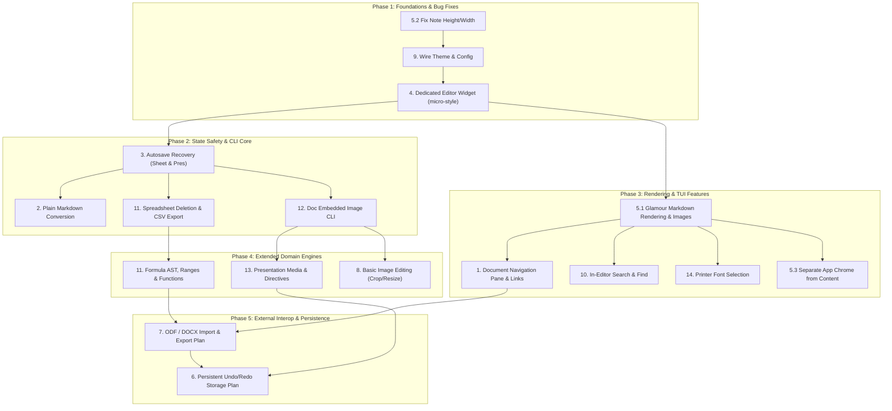

# Future Work

This document turns the items in the README's **Future work** section into
implementation plans. The plans follow Parchment's existing boundaries:
services own artifact rules, repositories own file I/O, and the TUI presents
those operations. Artifacts remain ordinary user-named files; application
state, recovery drafts, and persistent history belong under `~/.parchment/`.

## 1. Document navigation pane and in-document link navigation

Add structural navigation to documents. In-document link navigation, heading slugs,
anchors, and outline panes apply **strictly and exclusively to Documents**; they do
not apply to Notes (which are flat, unstructured notes) or Presentations (which use
slide-based sequencing).

### Document Editor Navigation Pane
- Add a dedicated navigation pane to the left side of the Document editor
  (visible by default on wide terminals `>= 80` columns, matching the reader, or
  toggled via shortcut like `F6` or `Ctrl+O`).
- The navigation pane dynamically parses and displays the document's structure:
  headings (H1–H6), section breaks, and explicit anchors.
- Clicking an entry with the mouse or navigating the pane via keyboard jumps the
  editor cursor (`Point {Line, Col}`) and scrolls the editor viewport directly to
  the line of that heading or anchor in the editable text buffer.
- This provides structural navigation during authoring without interfering with
  text editing or attempting unnatural click interception on raw editable text.

### In-Document Links in Preview and Reader Views Only
- In the text editor, Markdown links (`[text](#anchor)`) remain plain editable text.
  Links are **only clickable within the rendered document preview and reader views**.
- When rendering documents in the reader or preview (using Glamour):
  - Retain the rendered link spans and their destinations.
  - Mouse clicks on rendered links are hit-tested against terminal coordinates.
  - Clicking an internal link target jumps the reader/preview view directly to that
    target page and heading.
  - Unresolved internal links and external links remain styled as links but do not
    navigate.

### Slugging & Explicit Anchors
- Parse heading targets using deterministic slugging (GitHub-compatible: lowercase,
  spaces replaced by `-`, punctuation stripped, duplicate headings disambiguated
  with `-1`, `-2` suffixes).
- Support explicit HTML/Markdown anchor targets (`<a name="..."></a>` or `<a id="..."></a>`)
  in the document body, resolving them to their corresponding source lines and pages.
- Outline and slug extraction is purely a read operation performed in `internal/document`:
  it never alters or rewrites the user's canonical Markdown text.
- Test outline generation in the editor, heading slug generation, duplicate headings,
  explicit anchors, editor cursor jumping on pane selection, reader link hit-testing,
  and verify that Notes and Presentations remain completely decoupled from link logic.

**Acceptance:** The Document editor displays a left navigation pane that jumps the
cursor to headings/anchors upon selection. In document preview and reader views,
rendered inline Markdown links can be clicked to jump to target headings/pages.
Notes and presentations do not include link/anchor navigation.

## 2. Explicitly convert plain Markdown files

Add an explicit CLI conversion operation for turning a plain Markdown file
into a typed Parchment artifact. Those artifacts will be a Note, Document, or Presentation. Conversion will be in place, as requested,
but must ask for confirmation before adding Parchment metadata.

- Require the source path and an explicit artifact kind (initially note,
  document, or presentation). Do not infer the kind from a
  filename or make opening a plain note perform conversion. Instead, default
  to converting to Document with an option to pick note or presentation instead.
- Read and validate the existing plain file, preserve its Markdown body, and
  construct the selected kind's normal metadata and structured data. Do not
  add a stored title, ID, or path.
- Use the existing filesystem safeguards: detect changes since reading,
  write atomically in the source directory, preserve permissions, and leave
  the file unchanged if the user declines or validation fails. Refuse to
  convert a file that already has Parchment metadata.
- Test each supported kind, plain-body preservation, declined confirmation,
  invalid kinds, already-converted files, external-edit conflicts, and
  filesystem write failures.

**Acceptance:** Opening and saving plain Markdown retains current behavior;
only the explicit, confirmed command changes it into a Parchment artifact.

## 3. Autosave spreadsheet and presentation recovery drafts

Extend the existing recovery flow used by notes and documents to the
spreadsheet and presentation editors. The recovery store already accepts
kind-tagged JSON snapshots keyed by artifact path, so drafts can stay in
`~/.parchment/recovery/` without adding sidecars.

- Define a versioned snapshot for each editor. A spreadsheet snapshot must
  include the workbook data and the pending cell edit; a presentation
  snapshot must include the source currently in the editor. Keep recovery
  serialization separate from artifact serialization.
- Start a cancellable autosave timer only while an editor has unsaved work.
  Save through the existing recovery store, report failures in the editor,
  and ensure cancellation prevents a late save from recreating a draft after
  save or close.
- On reopen, offer recover, discard, or quit-and-keep behavior consistent
  with notes/documents. Validate draft kind and contents before restoring;
  saving recovered work must continue to use normal external-edit conflict
  checks.
- Delete drafts after a successful save or normal close; retain them after an
  abnormal exit or a failed cleanup and surface cleanup errors.
- Test autosave ticks and cancellation with model messages and a temporary
  recovery store, including malformed drafts, declined recovery, successful
  save cleanup, and interrupted-exit recovery.

**Acceptance:** Unsaved spreadsheet and presentation edits can be recovered
after an abnormal exit, with the same conflict protection and cleanup behavior
as note/document drafts.

## 4. Dedicated text editor widget with micro-style selection

Replace `bubbles/textarea` across the note, document, and presentation source
editors with a purpose-built text editor widget (`internal/tui/editor`) that
delivers text selection and editing ergonomics similar to [micro](https://github.com/micro-editor/micro).

### Architecture
- **Buffer**: Line-based rune buffer `Lines [][]rune` providing predictable
  Unicode indexing, line slicing, and atomic range replacement.
- **Cursor**: `Point {Line, Col}` with sticky visual column memory when
  moving vertically across lines of varying lengths.
- **Selection**: Explicit `Selection {Anchor Point, Active bool}` model
  (mirroring micro's `[2]Loc`). Selection spans from `min(Anchor, Cursor)` to
  `max(Anchor, Cursor)`.
- **Viewport**: Tracks `TopLine`, `LeftCol`, `Width`, and `Height`, supporting
  clean vertical scrolling and horizontal/soft wrapping without de-syncing
  internal offsets.

### Interaction & Key Handling
- **Selection expansion**: `Shift+Left`/`Shift+Right`, `Shift+Up`/`Shift+Down`,
  `Shift+Home`/`Shift+End`, and `Ctrl+Shift+Left`/`Ctrl+Shift+Right` expand or
  contract the selection relative to `Anchor`.
- **Selection collapse**: Any unshifted navigation (`Left`, `Right`, `Up`,
  `Down`, `Home`, `End`) collapses the selection to the current cursor position
  (`Anchor = Cursor`, `Active = false`).
- **Destructive editing**: When a selection is active, typing any printable rune,
  `Enter`, `Tab` (inserts two spaces by default), `Backspace`, or `Delete`
  atomically deletes the selected span before applying the edit.
- **Word navigation & deletion**: `Ctrl+Left`/`Ctrl+Right` jump by word boundary;
  `Ctrl+Backspace`/`Ctrl+Delete` remove the previous/next word.
- **Clipboard integration**: `Ctrl+C` copies the selected text to the system
  clipboard via `atotto/clipboard`; `Ctrl+X` cuts it; `Ctrl+V` pastes clipboard
  contents, replacing any active selection.
- **Mouse interaction**: Click-and-drag creates a visible range selection;
  double-click selects the word under cursor; triple-click selects the full
  line. Clicks directly map terminal X/Y to buffer `(Line, Col)`, replacing the
  ANSI-probing logic in `placeTextareaCursor`.

### Rendering & Integration
- Render selected spans natively during line layout by applying Lip Gloss
  highlight styling (`lipgloss.NewStyle().Reverse(true)` or theme accent)
  directly to runes, avoiding brittle ANSI string manipulation.
- Integrate the shared editor component across `noteEditor`, `documentsScreen`,
  and `presentationModel`.
- Directly powers **Future Work Item 10** (in-editor search & find) by sharing
  the same visual span highlight renderer for search matches.
- Correctly fills the entire allocated terminal width and height, resolving the
  note editor sizing deficit (**Section 5.2**).
- Add model-level unit tests for rune buffer operations, selection bounds,
  word movement/deletion, multi-line replacement, clipboard interactions, and
  isolation from reader/grid navigation modes.

**Acceptance:** Text editors in notes, documents, and presentations provide
fluid, visual text selection and editing identical to micro, including
Shift+arrows, mouse drag, clipboard operations, and destructive replacement.

## 5. Improve rendering and TUI layout

### Render Markdown in viewers and previews

- Adopt `github.com/charmbracelet/glamour` for terminal Markdown rendering
  shared across document reader pages, note previews, and presentation slide
  previews. Parchment aims to be an all-in-one terminal productivity suite,
  accepting Glamour's dependency footprint in exchange for rich, polished, and
  standard-compliant terminal typography.
- Differentiate image presentation between editor and preview contexts:
  - **In the editor**: Embedded images appear cleanly as canonical Markdown
    links `` or concise interactive placeholder badges,
    keeping text editing fast, lightweight, and uncluttered.
  - **In document preview & reader**: Embedded images are rendered as actual
    graphical images within the terminal page layout. The renderer decodes the
    image bytes (`PNG`, `JPEG`, `GIF`) stored in the document payload and renders
    them using terminal graphics protocols (Kitty graphics protocol, Sixel,
    iTerm2 inline images) with a 24-bit truecolor ANSI half-block pixel fallback
    for standard terminal emulators. Images scale proportionally to the page or
    column width.
- Keep the renderer pure and decoupled from artifact persistence: it must not
  mutate saved files or canonical Markdown.
- Filter reserved `parchment-*` blocks from display using existing artifact
  rules while preserving ordinary code fences. Keep document page breaks, section
  layout, and preview/reader link hit-testing integrated with rendered output.
- Integrate Glamour style sheets with Parchment's theme system (**Section 9**),
  supporting light, dark, and auto terminal color schemes.
- Test rendering at narrow and wide widths, ordinary versus reserved code
  fences, long lines, Unicode, image scaling, and preservation of canonical
  source text.

### Use the available terminal height in the note editor

- Verification confirms the issue is still present: `resizeEditors` calculates
  `bodyInput.SetHeight(max(height-5, 3))` and `SetWidth(max(width-8, 20))`, but
  `Model.View()` renders only 4 non-textarea lines (header, state, blank line,
  and status line). This leaves 1 row unused at the bottom of the terminal and
  an 8-column right margin.
- Adjust the note editor height and width calculations so the textarea fills the
  entire remaining terminal height and width, keeping it responsive to resize
  events and minimum terminal sizes.
- Add model/view regression tests verifying exact line budget and column usage
  at representative terminal dimensions.

### Separate application chrome from artifact content

- Give headers, footers, status, undo/redo indicators, and editor content
  consistent visual boundaries using the existing theme and Lip Gloss styles.
- Apply the layout consistently to note, document reader/editor, spreadsheet,
  and presentation screens. Keep content readable in both terminal themes and
  avoid clipping when the terminal is narrow or short.
- Add model/view tests for line budgets and representative narrow, wide, and
  minimum terminal sizes.

**Acceptance:** Common Markdown is visibly formatted via Glamour, images
display as clean links/placeholders in text editors and as fully rendered
graphics in document previews/readers, editor layout uses available terminal
space, and app chrome is distinguishable from artifact content across screens.

## 6. Plan persistent undo/redo storage format

Make a plan for persistent, bounded, per-file undo/redo history stored under
`~/.parchment/history/`. This work item is **planning only**; the implementation of
the persistent storage engine will follow this architectural design.

### Storage Strategy: Content-Addressable Blobs vs. Diffs
- **Evaluation of Text Diffs**: Parchment artifacts blend Markdown text with
  structured JSON payload fences (`parchment-*` code blocks) and binary data
  (base64 encoded images, spreadsheet cell models). Forward/backward unified
  diffs on structured and base64 content are fragile, computationally expensive to
  apply reliably across schema updates, and prone to corrupting binary blocks.
- **Evaluation of Monolithic Snapshots**: Storing full file duplicates for every
  keystroke or undo step rapidly exhausts disk space, especially for documents
  with embedded high-resolution images.
- **Recommended Architecture**: A hybrid content-addressable blob store with a
  per-artifact index manifest:
  - Snapshots capture the exact canonical artifact file bytes at each saved step.
  - Large binary payloads and unchanged file contents are hashed (SHA-256) and
    stored deduplicated in a shared blob pool (`~/.parchment/history/blobs/<sha256>`).
  - Identical images and unchanged blocks across multiple undo steps share the
    exact same underlying blob on disk.
  - Snapshot files and blobs are created with strict owner-only permissions (`0600`)
    and directories with `0700`.

### Directory Structure & Manifest Schema
History is organized beside the existing recovery store under `~/.parchment/`:
```
~/.parchment/
├── recovery/                    # Existing autosave recovery drafts
└── history/
    ├── blobs/                   # Deduplicated immutable content blobs (0600)
    │   ├── 4a8b1...
    │   └── e3b0c...
    └── <path-sha256>/           # Per-artifact history keyed by absolute path hash
        ├── index.json           # Stack manifest, pointer, and step metadata
        └── journal.json         # In-flight transition journal for crash recovery
```

**Manifest Schema (`index.json`)**:
- `schema_version`: Format version integer (e.g. `1`).
- `artifact_path`: Absolute path of the tracked artifact file.
- `undo_limit`: Maximum number of undo steps retained (default `100`, configured via `undo_limit` / `PARCHMENT_UNDO_LIMIT`).
- `head_index`: Zero-based index into `entries` pointing to the current state (-1 if empty).
- `entries`: Ordered array of history snapshots:
  - `id`: Monotonic step ID or UUID.
  - `timestamp`: UTC ISO-8601 timestamp.
  - `description`: Human-readable label (e.g. `"Edit text"`, `"Accept proposal"`, `"Delete column"`).
  - `file_digest`: SHA-256 hex digest of the artifact on disk at this state.
  - `blob_hash`: SHA-256 hex digest referencing the snapshot in `blobs/<blob_hash>`.
  - `byte_size`: File size in bytes.

### Crash Recovery & Transition Journaling
To prevent corruption if the process is terminated mid-transition (e.g., power loss
or SIGKILL between disk write and history pointer update), use a two-phase journaled
commit:
1. **Prepare**: Write `journal.json` atomically:
   `{"transition_id": "...", "from_digest": "...", "to_digest": "...", "target_head": N, "status": "pending"}`.
2. **Apply**: Atomically overwrite the artifact file with the target blob contents
   using `writeAtomic` and sync directory metadata.
3. **Commit**: Atomically update `index.json` with `head_index = target_head`.
4. **Finalize**: Remove `journal.json`.

**Startup / Reopen Resolution**:
- When opening an artifact, check if `journal.json` exists for its path hash.
- Compare the current disk file's SHA-256 digest against `from_digest` and `to_digest`:
  - If current file matches `to_digest`: The file write succeeded before `index.json` was committed. Commit `index.json` to `target_head` and delete `journal.json`.
  - If current file matches `from_digest`: The process crashed before writing the file. Delete `journal.json` (rollback).
  - If current file matches neither: An external modification occurred during an interrupted transition. Retain both file and history, display an explicit conflict warning, and refuse automated recovery.

### External Modification & Conflict Handling
- Before executing any `Undo()` or `Redo()` operation, compute the SHA-256 digest of
  the artifact file currently on disk and compare it with `entries[head_index].file_digest`.
- If the digests do not match:
  - An external edit occurred (e.g. file modified in an external editor or switched by Git).
  - **Do not overwrite the external edit.** Refuse the undo/redo operation and report:
    `"File modified externally; persistent history preserved for recovery."`
  - History remains intact and can be inspected or explicitly recovered if requested.

### Retention, Pruning & Garbage Collection
- **Branch Truncation**: When a new edit is saved while `head_index < len(entries)-1`,
  drop all subsequent redo entries (standard linear history model).
- **History Bounding**: When total entries exceed `undo_limit`, prune the oldest
  entries from `index.json`.
- **Blob Garbage Collection**: Unreferenced blobs in `~/.parchment/history/blobs/`
  are reclaimed via an automated or CLI-invoked garbage collection pass (`parchment history gc`),
  which builds the set of active `blob_hash` references across all `index.json` files
  and removes unreferenced blob files.
- **Purge CLI**: Support `parchment history clean <path>` to remove history for a
  specific file and `parchment history clean --all` to purge all persistent history.

### Service & Architecture Boundaries
- Define the history persistence abstraction in `internal/history`:
  ```go
  type Store interface {
      Load(ctx context.Context, path string) (*Stack, error)
      Save(ctx context.Context, path string, stack *Stack) error
      Record(ctx context.Context, path string, desc string, data []byte) error
      Undo(ctx context.Context, path string) ([]byte, string, error)
      Redo(ctx context.Context, path string) ([]byte, string, error)
      Purge(ctx context.Context, path string) error
  }
  ```
- Implement the storage engine in `internal/filerepo` beside `recovery.Store`.
- Keep domain services (`document`, `note`, `spreadsheet`, `presentation`) dealing
  strictly with high-level undo/redo operations, leaving file hashing, blob storage,
  and journal recovery inside the repository.

**Acceptance:** A fully documented, verified architectural plan for persistent undo/redo
is established covering storage schemas, blob deduplication, crash recovery journaling,
external edit conflict detection, and interface boundaries. Implementation is deferred
to follow this plan.

## 7. Import and export ODF and DOCX

Plan document conversion around Markdown text, basic document layout, and
embedded images. Conversion is intentionally lossy: Parchment does not
represent multiple fonts, exact image/object positioning, or every feature
available in office formats. Import/export must report unsupported or
approximated content rather than implying a lossless round trip.

- Define a documented mapping for headings, paragraphs, lists, page size,
  orientation, margins, columns, headers/footers, and embedded images between
  Parchment documents and ODF Text (`.odt`) / Word (`.docx`). Leave unsupported
  features such as precise object placement and multiple per-section fonts
  out of the Parchment model and include them in conversion warnings.
- Implement format-specific adapters behind a document import/export
  boundary, keeping archive/XML details out of the document domain model.
  Evaluate maintained Go libraries against the required subset before
  choosing dependencies; limit archive and XML processing to the selected
  document formats.
- Add path-based CLI import/export commands. Import creates a user-named
  Markdown artifact; export creates a user-named ODF or DOCX file. Refuse
  accidental overwrites, preserve the source file, and embed images in the
  output document rather than creating asset sidecars.
- Use small checked-in fixtures for representative ODF and DOCX files,
  plus generated export fixtures where useful. Test content/layout mappings,
  embedded images, malformed or unsupported input, warnings, and
  non-overwrite behavior.

**Acceptance:** The four operations—ODF export, DOCX export, ODF import, and
DOCX import—work for the documented subset, preserve source files, and
explain losses and unsupported features.

## 8. Basic image editing

Add crop and resize operations for image files opened directly by Parchment.
Keep images as ordinary files at user-chosen paths; do not wrap them in
Markdown artifacts or add per-image sidecars.

- Start with an explicit image service and path-based CLI operations. Support
  common static PNG and JPEG inputs first, and report unsupported formats
  rather than silently changing them.
- Accept crop bounds and resize dimensions explicitly, validate positive
  dimensions and source bounds, and preserve aspect ratio when the user asks
  for proportional resizing. Make interpolation and JPEG quality documented
  defaults if they are exposed.
- Write to an explicit output path by default, preserving the original.
  Allow same-path replacement only after explicit user choice; use atomic
  writes, preserve existing permissions, and apply owner-only permissions to
  newly created output files.
- Add a basic image view in the TUI with clear crop/resize controls only if
  direct image opening is not already surfaced by the application. Keep image
  processing outside the TUI and test it with generated fixtures in temporary
  directories.
- Test format support, invalid geometry, aspect ratio, output-path behavior,
  same-path confirmation, write errors, and image dimensions/pixel results.

**Acceptance:** Users can crop or resize a directly opened supported image
without unintended loss or modification of the original.

## 9. Connect configuration settings to runtime behavior

Wire up the parsed configuration fields in `config.Settings` and their
environment variable overrides to actual application behavior. Currently, only
`undo_limit` is connected to the runtime.

- **Theme**: Connect `theme` (and `PARCHMENT_THEME`) to TUI styling across all
  screens (note editor, document reader/editor, spreadsheet grid, presentation
  viewer). Support adaptive, light, and dark modes as well as user-configurable
  accent and border palettes, replacing the hardcoded hex colors.
- **Logging**: Implement a lightweight logging layer that honors `logging.level`
  and `logging.format` (`PARCHMENT_LOG_LEVEL`, `PARCHMENT_LOG_FORMAT`), writing
  owner-only logs to `~/.parchment/parchment.log` without polluting stdout or TUI
  screens.
- **Local backup**: When `backup.local.destination` is configured, automatically
  create an atomic, timestamped snapshot copy of an artifact upon successful
  save, preserving source file permissions.
- Test setting precedence (defaults -> TOML config -> environment variables),
  theme application across models, log file generation, and backup creation.

**Acceptance:** Configured theme, logging, and backup options directly
govern application and TUI behavior instead of being ignored.

## 10. In-editor search and find

Add in-editor find and search capabilities across all interactive TUI views
(note editor, document reader and editor, spreadsheet grid, and presentation
viewer) without relying on external shell commands.

- Provide a consistent search shortcut (such as `/` or `Ctrl+F`) opening a
  minimal search input bar.
- Support case-insensitive text matching within the active viewport and full
  content. Highlight matches visibly using theme-appropriate styling.
- Provide `Enter`/`n` for next match and `Shift+Tab`/`N` for previous match,
  scrolling the viewport or moving the cell selection directly to the match.
  `Esc` clears the search and dismisses the input bar.
- For spreadsheets, search both cell values and formula expressions; for
  presentations, search visible slides and optional speaker notes.
- Test hit navigation, case sensitivity, search cancellation, scrolling to
  off-screen matches, and empty query handling across all TUI models.

**Acceptance:** Users can search and jump to matches directly within any open
artifact in the TUI.

## 11. Spreadsheet row/column deletion and expanded formula engine

Extend spreadsheet capabilities with deletion operations, a formal formula AST
parser, standard aggregate functions, and CSV export.

### Formula Grammar & AST Architecture
Replace the ad-hoc recursive arithmetic evaluator in `internal/spreadsheet/formula.go`
with an explicit Lexer, AST, and Evaluator pipeline:

- **EBNF Grammar**:
  ```
  Expression   = Term { ("+" | "-") Term } ;
  Term         = Factor { ("*" | "/") Factor } ;
  Factor       = [ "+" | "-" ] Primary ;
  Primary      = Number
               | StringLiteral
               | FunctionCall
               | Range
               | CellRef
               | RefError
               | "(" Expression ")" ;
  FunctionCall = IDENT "(" [ ArgumentList ] ")" ;
  ArgumentList = Argument { "," Argument } ;
  Argument     = Range | Expression ;
  Range        = [ SheetRef "!" ] CellRef ":" CellRef ;
  CellRef      = [ SheetRef "!" ] IDENT ;
  SheetRef     = IDENT | SingleQuotedString ;
  RefError     = "#REF!" ;
  ```
- **AST Nodes**: Define typed AST structures (`BinaryExpr`, `UnaryExpr`, `NumberLiteral`,
  `StringLiteral`, `CellReference`, `RangeReference`, `FunctionCall`, `RefErrorNode`)
  in `internal/spreadsheet/formula/`.

### Built-in Aggregate Functions & Types
Support standard spreadsheet functions accepting arbitrary comma-separated
arguments (scalars, expressions, and rectangular ranges):
- `SUM(args...)`: Computes the sum of all numeric values across scalar arguments
  and cell ranges; blank cells and non-numeric strings in ranges are ignored.
- `AVERAGE(args...)`: Computes the arithmetic mean of numeric cells in arguments/ranges;
  returns `#DIV/0!` if no numeric cells exist.
- `COUNT(args...)`: Returns the count of cells containing numeric values.
- `MIN(args...)` / `MAX(args...)`: Returns the minimum or maximum numeric value
  across arguments and ranges; returns `#VALUE!` if no numeric cells exist.

### Error Values & Propagation
Model errors as first-class formula values that propagate up through expressions:
- `#REF!`: Produced when referencing a deleted row, column, or sheet, or referencing
  coordinates beyond workbook bounds.
- `#DIV/0!`: Division by zero or `AVERAGE` on empty/non-numeric ranges.
- `#NAME?`: Unrecognized function name or malformed identifier.
- `#VALUE!`: Incompatible types (e.g. arithmetic on text strings).
- `#CIRCULAR!`: Circular reference detected during dependency graph evaluation.

### Reference Shifting & Invalidation Algorithm on Deletion
When deleting rows, columns, or sheets, rewrite formulas across all worksheets:
- **Row deletion** (`spreadsheet delete-row <index>`):
  - Direct references to the deleted row become `#REF!`.
  - References with `row > deletedRow` decrement row index (`row--`).
  - Ranges (`A1:A10`): If boundary rows shift, resize the range (e.g. deleting row 5
    adjusts to `A1:A9`). If the entire range was contained in deleted rows such that
    it collapses to zero cells, replace with `#REF!`.
- **Column deletion** (`spreadsheet delete-column <index>`):
  - Direct references to the deleted column become `#REF!`.
  - References with `col > deletedCol` shift left (`col--`).
  - Ranges adjust boundaries or collapse to `#REF!` if fully deleted.
- **Sheet removal** (`spreadsheet delete-sheet <name>`):
  - Cross-sheet references to the removed sheet (`SheetName!A1`, `SheetName!A1:B10`)
    are rewritten to `#REF!`.
  - Refuse to delete the last remaining sheet in a workbook.

### Cross-Sheet Evaluation & Dependency Management
- Support cross-sheet syntax: `Sheet2!A1`, `'Q3 Revenue'!B2:D10`.
- The evaluator tracks visited coordinates `cellCoordinate{sheetIndex, row, column}`
  across worksheets in `visiting` and `cache` maps.
- Enforce `maxFormulaDepth = 512` across cross-sheet calls to prevent stack overflow
  and detect cycles.

### CSV Export Command
- Add `spreadsheet export <file> --csv [--sheet <name>] [-o <output-path>]`.
- Exports evaluated cell values (or raw string content) into RFC 4180 compliant CSV,
  handling quotes, commas, and newlines correctly.
- Test formula parsing, AST construction, function evaluations (`SUM`, `AVERAGE`,
  `COUNT`, `MIN`, `MAX`), `#REF!` propagation on row/column/sheet deletions,
  cross-sheet references, and CSV round-tripping.

**Acceptance:** Rows, columns, and sheets can be safely removed with formula
consistency, a dedicated AST parser and evaluator correctly computes functions
and ranges with standard error propagation, and workbooks can be exported to CSV.

## 12. Document embedded image management

Provide dedicated CLI commands to inspect, extract, and manage images embedded
within document artifacts.

- Add `document images <file>` to list all embedded images with their internal
  identifier (`image-<hash>.<ext>`), file format, byte size, and whether they
  are currently referenced in the Markdown body.
- Add `document image-extract <file> <image-name> -o <output-path>` to write
  embedded image bytes to an external file.
- Add `document image-remove <file> <image-name>` to remove an embedded image
  and optionally strip its Markdown references, ensuring clean artifact
  normalization.
- Test image listing, extraction fidelity against original byte slices, and
  pruning of unreferenced payloads.

**Acceptance:** Users can inspect and extract embedded images from document files
without manually decoding JSON blocks from the artifact file.

## 13. Presentation media, directives, and export

Enhance Markdown presentations with embedded media support, directive parsing,
and slide deck exporting.

- **Embedded media**: Extend presentation storage with a hidden payload block
  for embedded images, matching the document model. Allow referencing embedded
  images with standard Markdown image tags.
- **Present directives**: Support standard Go present command directives,
  beginning with `.image` and `.code` (including line-range filtering),
  rendering them appropriately in previews and slide viewers.
- **Slide export**: Add `presentation export <file> --format html|pdf` to
  generate standalone presentation output suitable for sharing or offline
  presenting.
- Test directive parsing, media embedding, payload preservation, and export
  output formatting.

**Acceptance:** Presentations can embed images, parse standard present
directives, and export to standalone slide formats.

## 14. Document and presentation printer font selection

Implement document- and presentation-wide font selection for printer-oriented
rendering, matching the design specified in the README.

- Expose font selection as a document layout property (`Font` field in `Layout`)
  and presentation metadata option, applicable strictly to printer output and
  page rendering.
- Keep terminal-based previews and TUI rendering bound to the terminal
  emulator's font, preserving terminal predictability.
- Support standard PostScript/PDF core monospaced and proportional font families
  or document-level font declarations for print pipelines.
- Test layout validation, serialization in payload blocks, and print output
  consistency across supported font specifications.

**Acceptance:** Font selection applies uniformly across printed document pages
without altering TUI terminal display.

## Suggested implementation order

The implementation order is structured into five distinct phases governed by
architectural dependencies. Executing these out of order risks rework, styling
conflicts, and broken coordinate hit-testing.



### Phase 1: Foundations & Bug Fixes
1. **Fix Note Editor Height and Width Allocation (Section 5.2)**: Correct the line budget
   and right margin calculation so textareas use available terminal space.
2. **Wire Theme & Configuration Settings (Section 9)**: Connect runtime theming
   (`theme` / `PARCHMENT_THEME`), file logging, and local backup snapshots before
   designing additional UI chrome.
3. **Dedicated Text Editor Widget (Section 4)**: Implement the line-based rune buffer
   (`Lines [][]rune`) and micro-style selection model (`internal/tui/editor`), replacing
   `bubbles/textarea` across notes, documents, and presentations.

### Phase 2: State Safety & CLI Core
4. **Autosave Recovery Drafts for Spreadsheet and Presentation (Section 3)**: Extend
   recovery store coverage to spreadsheet and presentation editors.
5. **Explicit Plain Markdown Conversion (Section 2)**: Add confirmed in-place conversion
   of plain Markdown files into typed Parchment artifacts.
6. **Spreadsheet Row/Column Deletion & CSV Export (Section 11)**: Add row/column/sheet
   deletion commands with reference shifting and CSV export.
7. **Document Embedded Image Management CLI (Section 12)**: Add image inspection,
   extraction, and removal commands.

### Phase 3: Rendering & TUI Features
8. **Terminal Markdown View-Layer Rendering with Glamour (Section 5.1)**: Integrate
   Glamour and dual-mode image handling (badges/links in editor, graphical rendering
   via Kitty/Sixel/iTerm2 with ANSI fallback in preview/reader).
9. **Document Editor Navigation Pane & Link Navigation in Preview/Reader (Section 1)**:
   Add the left-side outline navigation pane to the document editor and coordinate-mapped
   link hit-testing in rendered previews.
10. **In-Editor Search and Find (Section 10)**: Add uniform find across notes, documents,
    spreadsheets, and presentations using shared theme highlight styles.
11. **Document & Presentation Printer Font Selection (Section 14)**: Implement font
    selection for printed/paginated documents and presentations without affecting terminal fonts.
12. **Visual Separation of App Chrome (Section 5.3)**: Distinguish headers, footers,
    and status bars from artifact content.

### Phase 4: Extended Domain Engines
13. **Spreadsheet Formula AST, Ranges & Aggregate Functions (Section 11)**: Implement
    formal Lexer/AST, rectangular ranges (`A1:B10`), aggregate functions (`SUM`,
    `AVERAGE`, `COUNT`, `MIN`, `MAX`), and cross-sheet references.
14. **Presentation Media, Directives & Slide Export (Section 13)**: Support embedded images,
    Go present command directives (`.image`, `.code`), and HTML/PDF slide deck export.
15. **Basic Image Editing (Section 8)**: Implement crop and resize operations for
    directly opened image files.

### Phase 5: External Interop & Persistence
16. **Import and Export ODF / DOCX (Section 7)**: Plan and build document converters
    between Parchment Markdown and Word/ODF formats.
17. **Plan Persistent Undo/Redo Storage Format (Section 6)**: Design content-addressable
    blob store, journaled crash recovery, and conflict handling under `~/.parchment/history/`.

### Why This Order is Critical
1. **Foundational Input Widget before Recovery/Search (Item 4 before Items 3 & 10)**:
   Establishing the dedicated micro-style editor widget first ensures Note, Document,
   and Presentation editors share identical buffer state, selection logic, and cursor
   memory, avoiding rework on `bubbles/textarea`.
2. **Dynamic Themes before UI Chrome & Highlighting (Item 9 before Items 5.3 & 10)**:
   All TUI screens currently hardcode Lip Gloss hex colors. Designing search match
   highlights and status chrome before dynamic theming is connected would require
   restyling every view twice.
3. **Rich Rendering before Link Navigation (Item 5.1 before Item 1)**:
   Link hit-testing requires terminal X/Y coordinate mapping. Implementing links
   against monospaced raw text would break as soon as Glamour reflows and styles Markdown.
4. **Data Model Stability before Office Export (Items 1, 11, 12 before Item 7)**:
   ODF and DOCX converters must map headings, document links/anchors, and embedded
   images. If document schemas or image payloads change after DOCX export is written,
   the converters would require complete rewrites.
5. **Persistent History near the End (Item 6 last)**:
   Persistent undo/redo serializes snapshots across all artifact services. Stabilizing
   deletion, normalization, image payloads, and formula adjustments first ensures the
   persistent snapshot format does not suffer from schema migrations during development.

Each feature should include focused Go unit/model tests and use temporary
directories for filesystem behavior. Run `go test ./...` and
`go build ./cmd/parchment` as the final integration checks.
